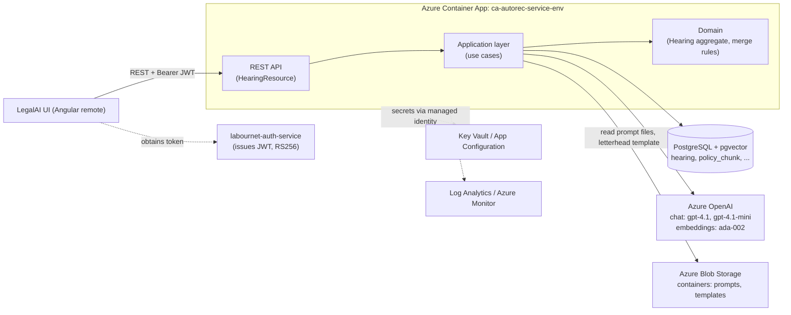
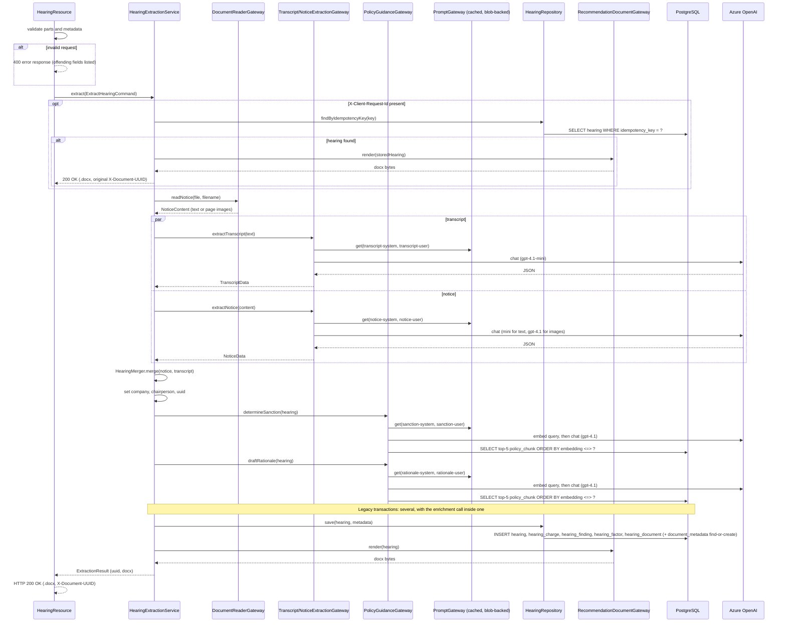
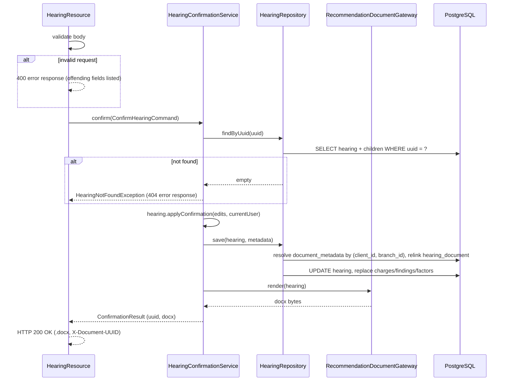
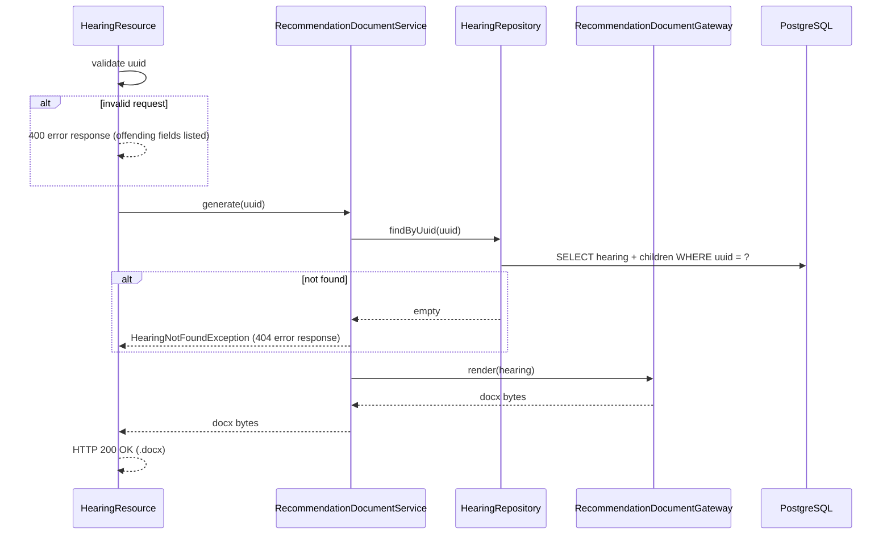
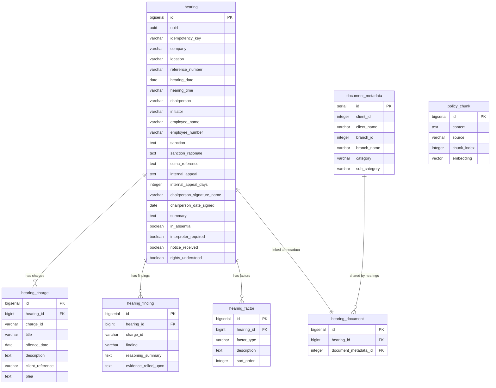

# Auto Recommendations - Hearing Recommendation LLD

## Design Overview

| | |
|---|---|
| **Microservice Name** | `auto-rec` (Gradle app `auto-rec-service`, Container App `ca-autorec-service-<env>`) |
| **Domain Manager Name** | Auto Recommendations |
| **Namespace** | `autorec` (Java base package `com.labournet.autorec`) |
| **Description** | The `auto-rec` microservice is the core domain service of the Auto Recommendations bounded context. It is the modernised replacement for the legacy `legalai-management-service` ("LegalAI"). It supports South African disciplinary-hearing chairpersons: from an uploaded hearing **transcript** and **notice to attend** it uses Azure OpenAI to extract a structured disciplinary enquiry (parties, procedural matters, charges, pleas, findings, aggravation, mitigation), persists it, uses retrieval-augmented generation over the disciplinary policy to recommend a sanction and draft the rationale, and renders a Labournet-letterhead Word (`.docx`) recommendation letter. It exposes REST APIs to extract and create a hearing, confirm the chairperson's edits and regenerate the letter from the stored hearing. |
| **Author** | @Progress Mlambo |
| **Status** | IMPLEMENTATION |

### Stakeholders

| Name | Role |
|---|---|
| Progress Mlambo | Software Engineer |
| Marius Venter / Gomolemo Tshenye | Architect |
| Paige Moollen | Delivery Lead |
| Janica Jansen van Rensburg | Product Owner |

---

## Table of Contents

- [Scope](#scope)
- [Out of Scope](#out-of-scope)
- [Assumptions](#assumptions)
- [Decisions](#decisions)
- [Architecture](#architecture)
- [APIs](#apis)
- [Service Logic](#service-logic)
- [Class Definitions (Implementation Contract)](#class-definitions-implementation-contract)
- [Data Model](#data-model)
- [Integration](#integration)
- [Non-Functional Requirements](#non-functional-requirements)
- [Error Handling](#error-handling)
- [Testing](#testing)
- [Appendices](#appendices)

---

## Scope

> **Migration rule.** This is a technical migration. It is not a process change, a functionality change or a business-requirement change. Anything that would alter these is excluded from this design and, if wanted, is raised separately with the business.

### In Scope

1. Accepting a hearing **transcript** (plain text) and a **notice to attend** (`.txt`, `.docx` or `.pdf`) together with client and branch metadata
2. Extracting a structured notice and a structured transcript with Azure OpenAI, using prompts read from external prompt files
3. Merging the notice and transcript data into one disciplinary enquiry (parties, procedural matters, charges and pleas, findings, aggravation, mitigation)
4. Persisting the hearing (parties, procedural matters, charges, findings, aggravation and mitigation factors, sanction, rationale, summary, advice, chairperson signature) and its client and branch reference
5. Retrieving the most relevant sections of the disciplinary policy, held as embedded chunks in the `policy_chunk` table (pgvector), to guide the recommendation
6. Recommending a sanction and drafting the summary and numbered rationale from the hearing data and the retrieved policy sections, using prompts read from external prompt files
7. Rendering the recommendation letter as a Word (`.docx`) document on the Labournet letterhead, using a letterhead template read from Azure Blob Storage
8. Accepting the chairperson's edits to a stored hearing (confirmation) and returning the updated letter
9. Regenerating the letter for a stored hearing
10. Exposing the APIs listed under [APIs](#apis)

### Out of Scope

These are capabilities the legacy `legalai-management-service` does not have. They are not designed here.

1. The user interface (the legacy repository contains only the backend)
2. APIs to list, search, retrieve as JSON, or delete hearings
3. Policy management per client, or policy versioning (the legacy has one bundled policy)
4. Asynchronous extraction (job and status)
5. Publishing or consuming domain events
6. Storing the uploaded transcript or notice (the legacy stores only the extracted data)

---

## Assumptions

**The legacy service is the behavioural source of truth.** This migration is not a process, functionality or business-requirement change, and it fixes no defects, with one approved exception: client errors return `400` and `404` per API best practice and every required field is validated (decision D11). Observable behaviour is otherwise retained exactly (see [Legacy behaviours retained](#legacy-behaviours-retained-raise-separately-with-the-business)). The only changes are the architecture-review externalisation of the prompts, the letterhead template, and the policy documents (loaded content produces identical output; policies are now synced automatically from blob storage at startup rather than loaded manually) and internal technical changes with identical observable behaviour.
Key design decisions and their rationale are recorded in the Design Decisions appendix of this document.

**The caller is authenticated by `labournet-auth-service`.** Tokens are RS256 JWTs with issuer `labournet-auth-service-<tier>`. The service reads `sub`, `email` and `name` and never calls the auth service. Whether existing LegalAI users hold tokens from this service is unconfirmed.

**The logged-in user is the chairperson.** `chairperson` and the signature name are set from the JWT identity (`name`, falling back to `email`, then `sub`). The chairperson named in the transcript is not used for the stored record.

**The hearing's company comes from the request metadata, not the transcript.** It is `documentMetadata.clientName` with a trailing parenthetical removed.

**Notice data wins over transcript data for charges, hearing date and time, location, reference number and party identity.** The pleas come from the transcript, matched by integer `charge_id`. Charge descriptions are **verbatim** from the notice.

**Source documents are not stored.** Only the extracted data is persisted. The transcript and notice exist in memory for the duration of the request. Retention of source documents is a business question.
**Notice reading is unchanged.** The notice is read as the legacy reads it (text from `.txt`, `.docx` and `.pdf`). Scanned PDFs behave as in the legacy and are listed under [Legacy behaviours retained](#legacy-behaviours-retained-raise-separately-with-the-business).

**Duplicate requests are detected via `X-Client-Request-Id`.** The caller supplies an `X-Client-Request-Id` header and reuses the same value on every retry of the same upload. The service stores it as `idempotency_key` on the `hearing` row. Before any AI work, `ExtractHearingService` queries `HearingRepository` for an existing hearing with that key. If found, it re-renders the letter from the stored hearing (the same path as `generateRecommendation`) and returns it with the original UUID — no AI calls, no DB write. If absent, the request proceeds normally and the key is saved with the hearing. If the header is not sent, the service creates a new hearing as before.

**Access is unchanged.** As in the legacy, any authenticated caller may read or modify any hearing. No ownership or role model is added.

**Policy content is synced from Blob Storage at startup.** The disciplinary policy is held as embedded chunks in the `policy_chunk` table, used for retrieval-augmented generation: the service embeds the recommendation query and retrieves the top 5 chunks by cosine distance (embedding model `text-embedding-ada-002`, 1536 dimensions). Policy documents (`.txt` and `.pdf` files) are stored in the `policies` blob container. On every startup `PolicyStartupSyncer` reads all files from that container via `BlobPolicyDocumentAdapter`, chunks them, embeds them via `PolicyEmbeddingAdapter`, and writes the results to `policy_chunk`. If the blob store is not configured, the existing rows are left unchanged and a warning is logged — the service still starts. When no rows exist, the legacy behaviour applies.

**Azure OpenAI deployments are `gpt-4.1` (full, vision, sanction and rationale) and `gpt-4.1-mini` (transcript and notice text), temperature 0.** Routing is explicit configuration, not method names.

**Prompts are external files, not code.** The legacy hard-coded all prompts in Java classes, so any wording change needed a deployment. This design moves them into prompt files read at runtime from the blob container `prompts`, so they can be modified without a deployment. There are eight files (notice, transcript, sanction and rationale, each with a system and a user prompt; see [Reference Data](#reference-data)). Each file is plain text with simple `{{placeholder}}` substitution and no logic. The legacy prompt text is moved into these files **verbatim first**; it changes afterwards only with a parity test proving equivalent output. Source copies of the files are kept in the repository under `prompts/` and published to the container by the pipeline, so they stay reviewable and testable.

**Prompt loading and change control.** Prompts are loaded at startup and cached in memory, and re-checked on a configurable interval with a conditional read (ETag), so an edit takes effect without a restart. If a refresh fails the last good version keeps being used. There is **no prompt text left in code to fall back to**: if no version of a required prompt can ever be loaded, the service reports not ready and the call that needs it fails as any other upstream failure does. Blob versioning is enabled on the container so every change is traceable and reversible, and the blob version identifier of each prompt used is written to the log. A prompt change alters legal output; who may write to the container is controlled by storage permissions and is a governance decision for the product owner.

**The letterhead template is a blob, not a bundled resource.** The legacy shipped `labournet_letterhead.docx` inside the jar (with `{{CONTENT}}` as the placeholder for the letter body), so a letterhead change needed a deployment. The template is now read from the blob container `templates` through `LetterheadTemplateGateway`, with the same behaviour as the prompts: cached in memory, refreshed with a conditional read, last good version kept on failure, and a readiness check. The legacy plain fallback layout is **kept**: when no template can be read, the letter is produced with that layout exactly as the legacy does. The `{{CONTENT}}` placeholder handling is unchanged from the legacy.

**The `hearing_date` column type must be verified in each live environment before the baseline migration is written.** The legacy schema declares `DATE` while the legacy entity mapped a `String`. This design maps `LocalDate`.

**Large text form fields need configuration.** The transcript is sent as a multipart text field (up to the 400,000-character cap). Quarkus' default maximum form-attribute size is small (2,048 bytes, **verify**), so `quarkus.http.limits.max-form-attribute-size` and `max-body-size` are set explicitly.

**Hosting is Azure Container Apps.** Ingress has its own request timeout (**verify the current limit**) that the legacy Azure Functions host (10 minutes) did not. The extraction flow stays synchronous as in the legacy, so the ingress timeout is set to cover it.

**Runtime is Java 25, Quarkus 3.30.7, Gradle 9.3.1.** The CI templates and the Dockerfile must pin the same Java version.

---

## Decisions

Design decisions, their rationale, and any open items are recorded in the Design Decisions appendix of this document. This section describes the design that follows from those decisions.

---

## Architecture

### High-Level Architecture Diagram

> The diagram below is the target runtime view. The platform pattern (module layout, conventions, hosting) follows the `omni-channel` and `labournet-doc-mgmt` services.



Layering follows the platform's **D-Agg-A hexagonal** pattern, with one Gradle module per layer (see [Package Structure](#package-structure)). Dependencies point inwards only: `api` and `adapter-*` depend on `application`, which depends on `domain`. The deployable app `apps/user-interface-api` is the composition root.

### Technology Stack

- **Java 25** (toolchain 25, `release 24` as in the platform convention plugins)
- **Quarkus 3.37.2**: Quarkus REST (`quarkus-rest-jackson`), Hibernate ORM with Panache, Flyway, SmallRye JWT, SmallRye OpenAPI, SmallRye Health, Micrometer
- **Gradle 9.6.1** (Kotlin DSL, `build-logic` convention plugins, version catalog) with **Nx** for the monorepo
- **OpenAPI Generator** (`jaxrs-spec`): contract-first; resources implement the generated interfaces
- **PostgreSQL** on the shared platform server (a per-service database and role) with the **pgvector** extension; the legacy runs 16
- **Azure OpenAI** (chat and embeddings) behind ports; official OpenAI Java SDK, isolated in `adapter-openai`
- **Apache POI** (DOCX read and write) and **Apache PDFBox** (PDF text and page rendering)
- **Azure Blob Storage** (`azure-storage-blob` SDK, managed-identity authentication) for the prompt files, the letterhead template, and the policy documents; isolated in the hearing `adapter-blob` module (prompts + templates) and the policy `adapter-blob` module (policy documents + embeddings)
- **REST** for all communication; **Azure Container Apps**, Azure Key Vault, Azure App Configuration; **Terraform** for infrastructure

---

## APIs

### API Endpoints

The interactive API explorer (Swagger UI) is at `https://<container-app-fqdn>/q/swagger-ui`. The FQDN is the `container_app_fqdn` Terraform output for the target environment.

All paths are relative to the application path `/api/v1` (`servers: /api/v1` in the OpenAPI files). They follow the platform naming, `/{context}/{resource}/{action}` with the context `recommendations`, as `omni-channel` does (`/communications/acs/...`). The legacy verbs, request and response bodies, field names, statuses and headers are unchanged.

| Use Case | Endpoint | Method | Operation id | Legacy path |
|---|---|---|---|---|
| Extract Hearing and Generate Recommendation | `/api/v1/recommendations/hearings/extract` | POST (multipart) | `extractHearing` | `/api/v1/legalai/extraction` |
| Confirm Hearing | `/api/v1/recommendations/hearings/confirm` | POST | `confirmHearing` | `/api/v1/legalai/extraction/confirmation` |
| Generate Recommendation Document | `/api/v1/recommendations/hearings/recommendation/generate` | POST | `generateRecommendation` | `/api/v1/legalai/recommendation/generate` |

The contract is written in the sibling style: `hearing.yaml` and `hearing-schemas.yaml` (tag `Hearings`: `extractHearing`, `confirmHearing`, `generateRecommendation`), with `bearerAuth` security and schema references of the form `./hearing-schemas.yaml#/components/schemas/X`. The live files are under `libs/recommendations/hearing/api/src/main/resources/`; the copies in `docs/openapi/` are kept as reference only.

> Note: Request and response schemas are defined contract-first in the OpenAPI files under `libs/recommendations/hearing/api/src/main/resources/`. They are generated into `*Api` interfaces and are not duplicated in this document. The legacy wire contract, including its known drift from the legacy OpenAPI file (`HearingDate` vs `hearingDate`, `internal_appeal_days` and the `DocumentMetadata` shape), is reproduced as the consumer sees it today. `charge_id` is `type: string` throughout; the service accepts a numeric value and converts it.

The legacy verbs are kept (all `POST`) even though a `GET` or `PUT` would be more RESTful. Only the paths are renamed; no legacy path is served as an alias. The only consumer change is the UI's three configured URLs (`legalAiExtractionUrl`, `legalAiConfirmationUrl` and `legalAiGenerateUrl` in `labournet-doc-mgmt`), which are switched at cut-over.

All binary responses use `application/vnd.openxmlformats-officedocument.wordprocessingml.document` with `Content-Disposition: attachment; filename="recommendation_<uuid>.docx"`, `Content-Length`, and (for extraction and confirmation) `X-Document-UUID`. CORS exposes `X-Document-UUID`, `Content-Disposition` and `X-Request-Id` through configuration.

### Validation

Every required request field and part is validated at the API boundary: Jakarta Bean Validation on the generated request models. All violations are collected and returned together as `400` with the legacy `ErrorResponse` body (`status` 400, `errorCode` `VALIDATION_ERROR`, `path`, `timestamp`), and the `message` lists each offending field and the reason, for example `documentMetadata.clientId is required; transcript must not be blank`. The rules come from what the legacy needs to work: its explicit checks, the fields it dereferences without a null check, and its database `NOT NULL` columns and lengths. The legacy itself used no validation annotations, so the same mistakes surfaced as `500`.

**extractHearing** (`multipart/form-data`)

| Part / Header | Required | Rule |
|---|---|---|
| `X-Client-Request-Id` | Recommended | If present, used as an idempotency key. The UI must generate this once per upload attempt and reuse it on every retry. If a hearing already exists for this key, the stored letter is returned immediately with no AI calls |
| `transcript` | Yes | Text, not blank |
| `notice` | Yes | File present. The legacy rejects a request without it; the doc-mgmt UI treats it as optional (it only appends it when a notice file was chosen), so the UI must guard this |
| `noticeFilename` | No | Used to tell the file type; without it the notice is read as a PDF |
| `filename` | No | Not used by the service |
| `documentMetadata` | Yes | JSON text, bare or wrapped as `{"documentMetadata": {...}}`; must parse; the object follows the DocumentMetadata rules below |

**DocumentMetadata** (in `extractHearing`, `confirmHearing`, and optionally in `generateRecommendation`)

| Member | Required | Rule |
|---|---|---|
| `clientId` | Yes | Whole number; numeric text is accepted and converted, as the legacy does (the UI sends text on extraction, a number on confirmation) |
| `clientName` | Yes | 1 to 100 characters, not blank (database column length) |
| `branchId` | Yes | Whole number; numeric text accepted |
| `branchName` | Yes | 1 to 255 characters, not blank |
| `category` | Yes | 1 to 100 characters, not blank |
| `subCategory` | Yes | 1 to 100 characters, not blank |

**confirmHearing** (`application/json`)

| Field | Required | Rule |
|---|---|---|
| `documentMetadata` | Yes | The DocumentMetadata rules above |
| `disciplinaryEnquiry` | Yes | Object |
| `disciplinaryEnquiry.uuid` | Yes | UUID of the stored hearing (a hearing that does not exist returns `404`) |
| `disciplinaryEnquiry.chairperson_signature` | Yes | Object; its `name` is replaced by the signed-in user |
| `disciplinaryEnquiry.mitigation` | Yes | List of text; may be empty. The letter reads it without a null check |
| `disciplinaryEnquiry.charges[].charge_id` | Yes, per charge | Text or number, up to 20 characters |
| `disciplinaryEnquiry.charges[].description` | Yes, per charge | Not blank |
| `disciplinaryEnquiry.findings[].charge_id`, `.finding` | Yes, per finding | Not blank; after normalisation (trim, lower-case, spaces, hyphens and underscores equivalent) it is `guilty`, `not_guilty` or `partially_guilty`, so "not guilty" and "not_guilty" are the same; anything else returns `400` (decision D12) |
| All other fields | No | A missing value is rendered blank in the letter, as the legacy does |

**generateRecommendation** (`application/json`)

| Field | Required | Rule |
|---|---|---|
| `disciplinaryEnquiry` | Yes | Object |
| `disciplinaryEnquiry.uuid` | Yes | UUID of the stored hearing (a hearing that does not exist returns `404`) |
| `documentMetadata` and all other fields | No | The service loads the stored hearing and ignores them |

The OpenAPI files in `docs/openapi/` carry the same rules (`required`, `minLength`, `maxLength`, `pattern`).

---

## Service Logic

### Extract Hearing and Generate Recommendation API

**Trigger:** REST API — `POST /api/v1/recommendations/hearings/extract` (`multipart/form-data`)
**Description:** Reads the uploaded notice and transcript, extracts and merges them into a disciplinary enquiry, determines the sanction and drafts the rationale from the policy, persists the hearing, renders the letter and returns it. Parts: `transcript` (text, required), `notice` (file, required), `noticeFilename` (text), `documentMetadata` (JSON string, required), `filename` (text, optional, logging only).

#### Process Flow

1. A multipart request comes in to create a hearing
2. The resource validates that `transcript` is non-blank, `notice` is present and `documentMetadata` parses with all six members present (see Validation under APIs). A failure returns `400` with the legacy `ErrorResponse` body, whose message lists each offending field (decision D11; the legacy returned `500`)
3. The resource maps the request to an `ExtractHearingCommand` and delegates to `ExtractHearingUseCase`
4. The service resolves the caller through `CurrentUserGateway`
5. **Idempotency check.** If `X-Client-Request-Id` was sent, the service calls `HearingRepository.findByIdempotencyKey(key)`. If a hearing is found, it renders the letter from the stored hearing via `RecommendationDocumentGateway` and returns `200 OK` with the original UUID — steps 6 to 13 are skipped
6. The service asks `DocumentReaderGateway` to read the notice. The adapter picks the strategy by file type: `.txt` as UTF-8 text; `.docx` text (paragraphs and table cells), falling back to embedded pictures when the text is 50 characters or fewer; PDF text through PDFBox (text only, as the legacy; a scanned PDF yields no text, see the appendix)
7. The service calls `TranscriptExtractionGateway` (mini deployment) and `NoticeExtractionGateway` (mini deployment for text, full deployment with vision for images). The two calls run one after the other, with no timeout, retry or circuit breaker added by our code, as in the legacy (the SDK's own default retry and timeout policy applies, and the new client is set to the same values). The adapter loads its **prompt text from `PromptGateway`** (the external prompt files; the current version of each file is read from the in-memory cache, and a missing prompt fails the call), and owns the placeholder substitution, the fence stripping, the truncated-JSON recovery for the transcript (truncated at 400,000 characters) and the unwrap of array-wrapped answers. The gateways return **typed** `TranscriptData` and `NoticeData`, never JSON
8. The domain `HearingMerger` merges them into a `Hearing`: notice charges replace transcript charges (keeping `charge_id`, `title`, `offence_date`, `description`, `client_reference`) with the `plea` taken from the transcript charge with the same `charge_id`; parties are merged **field by field with fallback to the transcript, keeping the transcript's chairperson and witnesses**; hearing date and time come from the notice only when the notice date is non-blank; location and reference number come from the notice only when non-blank (no wiping)
9. The service sets `company` from the metadata, `chairperson` and signature name from the caller, a new random `uuid`, and — if the header was sent — `idempotencyKey` from `X-Client-Request-Id`
10. The service asks `PolicyGuidanceGateway` for the **sanction phrase** (query: charge titles, descriptions, finding labels plus "sanction penalty disciplinary action") and for the **summary and rationale** (query built as the legacy builds it). Each call loads its prompts from `PromptGateway` and retrieves the top-5 policy chunks. Guidance failures are handled as the legacy handles them
11. The service persists the hearing as the legacy does: in several separate transactions, with the model enrichment call running inside one of them (60-second limit), so a failure part-way leaves a hearing without its recommendation; a retry with the same `X-Client-Request-Id` will be caught by the idempotency check in step 5. Metadata is resolved by `(clientId, branchId)` as the legacy does
12. The service asks `RecommendationDocumentGateway` to render the letter from the **persisted** hearing. The adapter takes the letterhead template from `LetterheadTemplateGateway` (cached from the `templates` container; the legacy fallback layout is used if no template can be read). A render failure behaves as in the legacy
13. `200 OK` is returned with the `.docx` and `X-Document-UUID`

#### Sequence Diagram



---

### Confirm Hearing API

**Trigger:** REST API — `POST /api/v1/recommendations/hearings/confirm` (JSON)
**Description:** Saves the chairperson's edits to the hearing and re-renders the letter from the persisted state. The body is the `DisciplinaryEnquiryResponse` envelope (`documentMetadata`, `disciplinaryEnquiry`); `disciplinaryEnquiry.uuid` identifies the hearing.

#### Process Flow

1. A request comes in to confirm the edits to an existing hearing
2. The resource validates the body against the contract (`400` with the offending fields listed otherwise; see Validation under APIs). `finding` values are normalised (trim, lower-case, spaces, hyphens and underscores equivalent), so "not guilty" and "not_guilty" mean the same; a value still unrecognised returns `400` naming `finding` (decisions D12 and D11)
3. The resource maps to a `ConfirmHearingCommand` and delegates to `ConfirmHearingUseCase`
4. The service loads the hearing by `uuid` through `HearingRepository`. If not found, `404` is returned with the legacy `ErrorResponse` body (decision D11; the legacy returned `500`)
5. The domain `Hearing.applyConfirmation(...)` applies the edits exactly as the legacy confirmation does, and `chairperson` and the signature name are set from the caller
6. The metadata is resolved and stored as the legacy does, by `(clientId, branchId)`
7. The repository saves the hearing with the legacy transactions
8. The service renders the letter from the persisted hearing (not the request payload) and returns it
9. `200 OK` is returned with the `.docx` and `X-Document-UUID`

#### Sequence Diagram



---

### Generate Recommendation Document API

**Trigger:** REST API — `POST /api/v1/recommendations/hearings/recommendation/generate` (JSON)
**Description:** Re-renders the recommendation letter for a stored hearing. No LLM call and no policy retrieval is made. Only `disciplinaryEnquiry.uuid` is read from the body.

#### Process Flow

1. A request comes in to regenerate the letter for the hearing identified by `disciplinaryEnquiry.uuid`
2. The resource validates that `disciplinaryEnquiry.uuid` is present (`400` otherwise) and delegates to `GetHearingRecommendationUseCase`
3. The service loads the hearing by `uuid`. If not found, `404` is returned with the legacy `ErrorResponse` body (decision D11; the legacy returned `500`)
4. The service asks `RecommendationDocumentGateway` to render the letter
5. `200 OK` is returned with the `.docx`

#### Sequence Diagram



---

## Class Definitions (Implementation Contract)

The service follows the platform's D-Agg-A hexagonal architecture: **each hexagonal layer is a separate Gradle module**. Inbound HTTP is handled by thin JAX-RS resources that implement the interfaces generated from the OpenAPI contract and delegate to **use cases**. A use case is an interface in the application layer; its implementation (a service) holds the business orchestration. In the headings below, *Controllers* are the REST resources, *Handlers* are the use-case interfaces and services, *Repositories* are the persistence ports with their Panache adapters, and *Response Mappers* are the hand-written `*ApiMapper` classes.

Layer rules (enforced by ArchUnit and Checkstyle, 0 warnings): `domain` has no setters and no JPA, JAX-RS, Quarkus, Jackson or SDK types, with classes only in the `model` and `exception` packages; `application` has no adapter, API, JAX-RS, JPA, CDI-container, Jackson or SDK dependencies; ports are interfaces and services implement a use case; all injection is by constructor.

### Package Structure

Module names follow `{context}-{aggregate}-{layer}` and are registered in `settings.gradle.kts`. The context is named `recommendations`.

```
auto-rec/
  apps/user-interface-api/                      (Gradle: auto-rec-service)  composition root
    AutoRecServiceApplication.java              @ApplicationPath("/api/v1")
    config/UrlMappingConfigSourceFactory.java   CORS origins and JWT issuer per tier
    src/main/resources/application.yml, url-mapping/url-mapping.json, jwt/auth-service-public-key.pem
    src/main/resources/db/migration/            Flyway baseline and forward scripts (single location)
  libs/recommendations/hearing/
    domain/                                     (Gradle: recommendations-hearing-domain)
      model/
        Hearing.java                            aggregate root
        Charge.java, Finding.java, FindingResult.java (enum with the normalising `fromText`, decision D12), HearingFactor.java, FactorType.java (enum)
        PartiesPresent.java, ProceduralMatters.java, Advice.java, Recommendation.java
        ClientBranchRef.java                    client/branch/category reference
        NoticeData.java, TranscriptData.java    typed extraction results
        HearingMerger.java                      merge rules (domain service)
      exception/
        HearingNotFoundException.java, NoticeUnreadableException.java
    application/                                (Gradle: recommendations-hearing-application)
      interfaces/usecases/
        ExtractHearingUseCase.java, ConfirmHearingUseCase.java, GetHearingRecommendationUseCase.java
      interfaces/gateway/
        DocumentReaderGateway.java, NoticeExtractionGateway.java, TranscriptExtractionGateway.java, PromptGateway.java, LetterheadTemplateGateway.java,
        PolicyGuidanceGateway.java, RecommendationDocumentGateway.java, CurrentUserGateway.java
      interfaces/repository/
        HearingRepository.java
      service/
        HearingExtractionService.java, HearingConfirmationService.java, RecommendationDocumentService.java
    adapter-postgres/                           (Gradle: recommendations-hearing-adapter-postgres)
      entity/  HearingEntity, HearingChargeEntity, HearingFindingEntity, HearingFactorEntity,
               HearingDocumentEntity, DocumentMetadataEntity
      HearingPanacheRepository.java, HearingRepositoryAdapter.java, HearingEntityMapper.java
    adapter-openai/                             (Gradle: recommendations-hearing-adapter-openai)
      OpenAiClientProvider.java, OpenAiNoticeExtractionAdapter.java, OpenAiTranscriptExtractionAdapter.java,
      OpenAiPolicyGuidanceAdapter.java, JsonRepair.java      (no prompt text in code: see adapter-blob)
    adapter-blob/                               (Gradle: recommendations-hearing-adapter-blob)
      BlobPromptAdapter.java            implements PromptGateway: reads prompt files, in-memory cache, ETag refresh, last-good fallback
      BlobLetterheadTemplateAdapter.java  implements LetterheadTemplateGateway: reads templates/labournet_letterhead.docx, cache, ETag refresh, last-good, validates the {{CONTENT}} placeholder
    adapter-documents/                          (Gradle: recommendations-hearing-adapter-documents)
      PoiPdfboxDocumentReaderAdapter.java, WordRecommendationDocumentAdapter.java   (no template file in the jar: the letterhead comes from LetterheadTemplateGateway)
    api/                                        (Gradle: recommendations-hearing-api)
      src/main/resources/legalai-hearing.yaml (+ schemas)
      HearingResource.java, HearingRequestMapper.java, JwtCurrentUserAdapter.java,
      HearingNotFoundExceptionMapper.java, ...ExceptionMappers
  libs/recommendations/policy/
    domain/        model/ PolicyChunk
    application/   usecases/ SearchPolicyUseCase; gateway/ EmbeddingGateway, PolicyDocumentGateway; repository/ PolicyRepository;
                   service/ PolicySearchService, PolicyIngestService, PolicyChunkWriter, PolicyStartupSyncer (syncs policy_chunk from blob at startup), EmbeddedChunk
    adapter-postgres/   PolicyChunkEntity, PolicyPanacheRepository, PolicyRepositoryAdapter (pgvector)
    adapter-blob/   (Gradle: recommendations-policy-adapter-blob)
      BlobPolicyDocumentAdapter.java   implements PolicyDocumentGateway: reads .txt and .pdf files from the policies blob container
      PolicyEmbeddingAdapter.java      implements EmbeddingGateway: calls Azure OpenAI ada-002 to embed policy chunk text
  libs/shared/async/    AsyncTaskExecutor (virtual-thread executor, as in omni-channel)
  libs/shared/blob/     BlobServiceClientProvider (managed-identity BlobServiceClient, used by the hearing adapter-blob module)
  prompts/               source copies of the eight prompt files (published to the prompts container by the pipeline)
```

The `PolicyGuidanceGateway` used by the hearing application layer is implemented by a small adapter that calls the policy application's `SearchPolicyUseCase` and the OpenAI chat client, so the hearing application layer never depends on the policy domain directly.

### Controllers

```java
/**
 * REST resource for the hearing endpoints. Implements the interface generated from
 * legalai-hearing.yaml, is @ApplicationScoped and @Authenticated, uses constructor
 * injection, and contains no business logic. All error responses use the generated
 * ErrorResponse via per-exception mappers.
 */
class HearingResource implements HearingApi {

    /**
     * Extracts, merges, persists and renders. Delegates to {@link ExtractHearingUseCase}.
     * Multipart parts are bound by ExtractionForm (@RestForm, FileUpload).
     * Returns the .docx with X-Document-UUID.
     */
    Response extractHearing(ExtractionForm form);

    /**
     * Applies the chairperson's edits and re-renders.
     * Delegates to {@link ConfirmHearingUseCase}. Returns the .docx with X-Document-UUID.
     */
    Response confirmHearing(ConfirmHearingRequest body);

    /**
     * Re-renders the letter for a stored hearing.
     * Delegates to {@link GetHearingRecommendationUseCase}.
     */
    Response generateRecommendation(GenerateRecommendationRequest body);
}
```

### Handlers

```java
/**
 * Use case for the Extract Hearing feature. Orchestrates notice reading, extraction,
 * merging, policy guidance, persistence and letter rendering.
 */
interface ExtractHearingUseCase {
    /**
     * @param command transcript text, notice bytes and filename, client/branch metadata
     * @return ExtractHearingResult containing the persisted hearing and the rendered .docx bytes
     * @throws ExtractionFailedException if extraction or merging cannot produce a hearing
     */
    ExtractHearingResult extract(ExtractHearingCommand command);
}
class HearingExtractionService implements ExtractHearingUseCase { /* constructor-injected ports */ }

/**
 * Carries the result of the extract flow.
 * @param hearing   the fully extracted and persisted hearing aggregate
 * @param docxBytes the rendered outcome letter as a DOCX byte array, produced inside the service
 */
record ExtractHearingResult(Hearing hearing, byte[] docxBytes) {
    String docUuid();  // hearing UUID as a string; avoids domain access in the API layer
}

/**
 * Use case for the Confirm Hearing feature. Applies edits exactly as the legacy
 * confirmation does, saves and re-renders from the persisted hearing.
 */
interface ConfirmHearingUseCase {
    /**
     * @throws HearingNotFoundException if no hearing exists for the uuid
     */
    ConfirmationResult confirm(ConfirmHearingCommand command);
}
class HearingConfirmationService implements ConfirmHearingUseCase { }

/**
 * Use case for the Generate Recommendation Document feature. Loads the stored
 * hearing and renders the letter. No LLM and no retrieval.
 */
interface GetHearingRecommendationUseCase {
    /** @throws HearingNotFoundException if no hearing exists for the uuid */
    GeneratedDocument generate(UUID hearingUuid);
}
class RecommendationDocumentService implements GetHearingRecommendationUseCase { }

/**
 * Domain service holding the legacy merge rules over typed models.
 * Lives in domain.model (no framework or JSON types).
 */
class HearingMerger {
    /**
     * Notice charges replace transcript charges, with plea copied by charge_id.
     * Parties merge field by field with transcript fallback, keeping the transcript
     * chairperson and witnesses. Hearing date/time, location and reference number
     * come from the notice only when non-blank.
     */
    Hearing merge(NoticeData notice, TranscriptData transcript);
}
```

### Repositories

```java
/**
 * Port for hearing persistence (application layer). The Panache adapter owns the
 * transaction handling of the legacy and the mapping between the domain Hearing and the JPA entities.
 */
interface HearingRepository {
    /** Persists the aggregate and its children with the legacy transactions; resolves client/branch metadata. */
    Hearing save(Hearing hearing, ClientBranchRef clientBranch);
    Optional<Hearing> findByUuid(UUID uuid);
    /** Returns the hearing whose idempotency_key matches, used to short-circuit duplicate extract requests. */
    Optional<Hearing> findByIdempotencyKey(String key);
}

/**
 * Adapter in recommendations-hearing-adapter-postgres. Uses HearingPanacheRepository and
 * HearingEntityMapper.
 */
class HearingRepositoryAdapter implements HearingRepository { }

/**
 * Port for policy similarity search (pgvector). The service only reads the policy rows.
 */
interface PolicyRepository {
    /** Returns the k chunks closest to the query embedding by cosine distance (<=>). */
    List<PolicyChunk> findTopK(float[] queryEmbedding, int k);
    /** Number of stored policy chunks, used for the startup log line. */
    long count();
}
class PolicyRepositoryAdapter implements PolicyRepository { }
```

Gateways (ports implemented by adapters): `DocumentReaderGateway.readNotice(...)`, `NoticeExtractionGateway.extract(...)`, `TranscriptExtractionGateway.extract(...)`, `PolicyGuidanceGateway.determineSanction(...)` and `draftRationale(...)`, `RecommendationDocumentGateway.render(Hearing)`, `EmbeddingGateway.embed(String)`, `PromptGateway.get(PromptId)` (implemented by `BlobPromptAdapter`), `LetterheadTemplateGateway.current()` (implemented by `BlobLetterheadTemplateAdapter`; returns the cached `.docx` template bytes and version), `CurrentUserGateway.current()` (implemented in the `api` module by `JwtCurrentUserAdapter`, which reads the injected `JsonWebToken`).

```java
/**
 * Port that supplies prompt text to the AI adapters. Implemented by BlobPromptAdapter,
 * which reads the prompt files from the blob container "prompts", keeps the current version
 * of each in memory, re-checks on a configurable interval with a conditional read (ETag),
 * and keeps serving the last good version if a refresh fails. There is no prompt text in
 * code to fall back to.
 */
interface PromptGateway {
    /**
     * @param id one of the eight prompt ids (see Reference Data)
     * @return the current template, its version identifier and its text
     * @throws PromptUnavailableException if no version of the prompt has ever been loaded
     */
    PromptTemplate get(PromptId id);
}

/**
 * An immutable prompt template. Rendering substitutes {{placeholder}} tokens only;
 * an unresolved placeholder is an error, not an empty string.
 */
record PromptTemplate(PromptId id, String version, String text) {
    String render(Map<String, String> values);
}
```

### Response Mappers

```java
/**
 * Maps request bodies to commands. Static, hand-written, no MapStruct in the domain.
 * Re-serialises the confirm request to a Jackson JsonNode tree to work around broken
 * oneOf wrapper classes generated for charge_id and finding_charge_id.
 */
class HearingRequestMapper {
    static ConfirmHearingCommand toConfirmCommand(ConfirmHearingRequest body, CurrentUser user);
    static ExtractHearingCommand toExtractCommand(ExtractionForm form, CurrentUser user);
}
```

### Class Diagram

```mermaid
classDiagram
    class HearingResource {
        +extractHearing(ExtractionForm) Response
        +confirmHearing(ConfirmHearingRequest) Response
        +generateRecommendation(GenerateRecommendationRequest) Response
    }
    class ExtractHearingUseCase {
        <<interface>>
        +extract(ExtractHearingCommand) ExtractionResult
    }
    class ConfirmHearingUseCase {
        <<interface>>
        +confirm(ConfirmHearingCommand) ConfirmationResult
    }
    class GetHearingRecommendationUseCase {
        <<interface>>
        +generate(UUID) GeneratedDocument
    }
    class HearingExtractionService
    class HearingConfirmationService
    class RecommendationDocumentService
    class HearingMerger {
        +merge(NoticeData, TranscriptData) Hearing
    }
    class Hearing {
        +applyConfirmation(edits, CurrentUser) void
    }
    class HearingRepository {
        <<interface>>
        +save(Hearing, ClientBranchRef) Hearing
        +findByUuid(UUID) Optional~Hearing~
    }
    class PolicyRepository {
        <<interface>>
        +findTopK(float[], int) List~PolicyChunk~
    }
    class DocumentReaderGateway { <<interface>> }
    class NoticeExtractionGateway { <<interface>> }
    class TranscriptExtractionGateway { <<interface>> }
    class PolicyGuidanceGateway { <<interface>> }
    class RecommendationDocumentGateway { <<interface>> }
    class EmbeddingGateway { <<interface>> }
    class CurrentUserGateway { <<interface>> }
    class HearingRequestMapper
    class PromptGateway {
        <<interface>>
        +get(PromptId) PromptTemplate
    }
    class LetterheadTemplateGateway { <<interface>> }
    class BlobPromptAdapter
    class BlobLetterheadTemplateAdapter

    HearingResource ..> ExtractHearingUseCase : delegates to
    HearingResource ..> ConfirmHearingUseCase : delegates to
    HearingResource ..> GetHearingRecommendationUseCase : delegates to
    HearingResource ..> HearingRequestMapper : uses
    HearingExtractionService ..|> ExtractHearingUseCase
    HearingConfirmationService ..|> ConfirmHearingUseCase
    RecommendationDocumentService ..|> GetHearingRecommendationUseCase
    HearingExtractionService --> DocumentReaderGateway : uses
    HearingExtractionService --> NoticeExtractionGateway : uses
    HearingExtractionService --> TranscriptExtractionGateway : uses
    HearingExtractionService --> PolicyGuidanceGateway : uses
    HearingExtractionService --> HearingMerger : uses
    HearingExtractionService --> HearingRepository : uses
    HearingExtractionService --> RecommendationDocumentGateway : uses
    HearingExtractionService --> CurrentUserGateway : uses
    HearingConfirmationService --> HearingRepository : uses
    HearingConfirmationService --> RecommendationDocumentGateway : uses
    RecommendationDocumentService --> HearingRepository : uses
    RecommendationDocumentService --> RecommendationDocumentGateway : uses
    HearingMerger --> Hearing : creates
    BlobPromptAdapter ..|> PromptGateway
    BlobLetterheadTemplateAdapter ..|> LetterheadTemplateGateway
```



---

## Data Model

All tables reside in the `public` schema of the service's PostgreSQL database. Names and column types stay **compatible with the legacy schema**  so existing hearings and policy chunks remain usable. Changes are additive or relaxing and are marked below.

### Design Principles

- The service owns only what is captured during the hearing journey. Client and branch data are owned elsewhere; only the identifiers and a minimal replica of the names are stored
- A hearing is one aggregate: `hearing` and its children (`hearing_charge`, `hearing_finding`, `hearing_factor`) are always saved and loaded together, as the legacy saves them (several transactions, see appendix L8)
- The domain model is not the JPA entity. Entities live only in `adapter-postgres`
- Shared reference rows (`document_metadata`) are **never mutated** by a hearing edit; a hearing is relinked to the matching row, created if needed (so editing one hearing cannot corrupt other hearings that share the row)
- `document_metadata` keeps the legacy unique index on `(client_id, branch_id)`
- Mutable tables carry four audit columns: `created_by`, `created_date`, `updated_by`, `updated_date` (legacy names kept for compatibility).
- Free-form JSON arrays (`sanction_rationale`, `evidence_relied_upon`) stay `TEXT` holding a JSON array for compatibility
- `finding` and `factor_type` are constrained by `CHECK` and by enums in the domain. `finding` text is normalised before it is converted (decision D12); on extraction a null or still-unrecognised value is stored as `guilty` and a warning is logged, as the legacy does
- pgvector stores the policy embeddings (`vector(1536)`); the extension is created by an administrator step, not by the application role
- Prompts are **not stored in the database**: they are blob files read at runtime, and the prompt versions used are written to the log only. The policy chunks in `policy_chunk` are rebuilt from the `policies` blob container on every startup
- Source documents (transcript, notice) are not stored
- All code field descriptions are informational; the service does not enforce reference tables on them beyond the `CHECK` constraints stated

### `hearing`

Core hearing record (aggregate root).

| Column | Type | Constraint | Description |
|---|---|---|---|
| `id` | BIGSERIAL | PK | Surrogate key |
| `uuid` | UUID | NOT NULL, UNIQUE | Public identifier, returned in `X-Document-UUID` |
| `idempotency_key` | VARCHAR(255) | UNIQUE, NULL | Value of `X-Client-Request-Id` on the request that created this hearing; NULL when the header was not sent |
| `company` | VARCHAR(255) | | From `documentMetadata.clientName`, trailing parenthetical removed |
| `location` | VARCHAR(255) | | Hearing venue |
| `reference_number` | VARCHAR(100) | | Notice/HR reference |
| `hearing_date` | DATE | | Mapped as `LocalDate` (legacy entity used a String; **verify the live column type before baselining**) |
| `hearing_time` | VARCHAR(50) | | Stored as text; exposed and updatable (legacy never exposed it) |
| `chairperson` | VARCHAR(255) | | Always the logged-in user |
| `initiator` | VARCHAR(255) | | |
| `employee_name` | VARCHAR(255) | | |
| `employee_number` | VARCHAR(100) | | |
| `employee_representative` | VARCHAR(255) | | |
| `employee_interpreter` | VARCHAR(255) | | |
| `company_witness_1` / `company_witness_2` | VARCHAR(255) | | |
| `employee_witness_1` / `employee_witness_2` | VARCHAR(255) | | |
| `sanction` | TEXT | | Sanction phrase |
| `sanction_rationale` | TEXT | | JSON array of numbered rationale paragraphs. **Never the string `"null"`** |
| `ccma_reference` | TEXT | | Collected; not rendered in the letter (open question) |
| `internal_appeal` | TEXT | | "yes"/"true" means an internal appeal is offered |
| `internal_appeal_days` | INTEGER | | Handled as the legacy handles it
| `chairperson_signature_name` | VARCHAR(255) | | Always the logged-in user |
| `chairperson_date_signed` | DATE | | |
| `summary` | TEXT | | 2 to 3 sentence outcome summary |
| `in_absentia` | BOOLEAN | NOT NULL DEFAULT FALSE | Whether the employee failed to attend the hearing |
| `interpreter_required` | BOOLEAN | | Procedural matters (tri-state: true/false/null) |
| `interpreter_language` | VARCHAR(255) | | |
| `interpreter_name` | VARCHAR(255) | | |
| `representative_required` | BOOLEAN | | |
| `representative_name` | VARCHAR(255) | | |
| `notice_received` | BOOLEAN | | |
| `notice_received_date` | VARCHAR(100) | | |
| `sufficient_time_to_prepare` | BOOLEAN | | |
| `rights_understood` | BOOLEAN | | |
| `procedure_explained` | BOOLEAN | | |
| `created_by` | VARCHAR(255) | | |
| `created_date` | TIMESTAMP | NOT NULL DEFAULT NOW() | |
| `updated_by` | VARCHAR(255) | | |
| `updated_date` | TIMESTAMP | NOT NULL DEFAULT NOW() | Also maintained by the legacy trigger `update_updated_date()` |

Indexes (legacy): `idx_hearing_uuid` (unique), `idx_hearing_reference`, `idx_hearing_employee`, `idx_hearing_date`, `idx_hearing_notice_received`, `idx_hearing_rights_understood`. The two procedural-flag indexes are candidates for removal.

### `hearing_charge`

| Column | Type | Constraint | Description |
|---|---|---|---|
| `id` | BIGSERIAL | PK | |
| `hearing_id` | BIGINT | NOT NULL, FK → hearing ON DELETE CASCADE | |
| `charge_id` | VARCHAR(20) | NOT NULL | "1", "2", ... (integer in the prompts) |
| `title` | VARCHAR(500) | | |
| `offence_date` | DATE | | |
| `description` | TEXT | NOT NULL | Verbatim from the notice |
| `client_reference` | VARCHAR(255) | | |
| `plea` | TEXT | | **Widened from VARCHAR(50)** so a free-text plea cannot fail the insert |
| audit columns | | | as above |

### `hearing_finding`

| Column | Type | Constraint | Description |
|---|---|---|---|
| `id` | BIGSERIAL | PK | |
| `hearing_id` | BIGINT | NOT NULL, FK → hearing ON DELETE CASCADE | |
| `charge_id` | VARCHAR(20) | NOT NULL | Matches `hearing_charge.charge_id` on the same hearing (validated in the domain) |
| `finding` | VARCHAR(20) | NOT NULL, CHECK in (`guilty`, `not_guilty`, `partially_guilty`) | |
| `reasoning_summary` | TEXT | | |
| `evidence_relied_upon` | TEXT | | JSON array |
| audit columns | | | |

### `hearing_factor`

Aggravation and mitigation, ordered.

| Column | Type | Constraint | Description |
|---|---|---|---|
| `id` | BIGSERIAL | PK | |
| `hearing_id` | BIGINT | NOT NULL, FK → hearing ON DELETE CASCADE | |
| `factor_type` | VARCHAR(20) | NOT NULL, CHECK in (`AGGRAVATION`, `MITIGATION`) | |
| `description` | TEXT | NOT NULL | |
| `sort_order` | INTEGER | NOT NULL DEFAULT 0 | |
| audit columns | | | |

### `hearing_procedural_statement`

The chairperson's own wording for the procedural matters section, ordered. Added in `V007`. Not in the legacy schema: legacy could only print the sentences generated from the boolean columns on `hearing`. When a hearing has rows here, the outcome letter prints them instead of the generated sentences; with no rows it behaves as before.

| Column | Type | Constraint | Description |
|---|---|---|---|
| `id` | BIGSERIAL | PK | |
| `hearing_id` | BIGINT | NOT NULL, FK → hearing ON DELETE CASCADE | |
| `statement` | TEXT | NOT NULL | One numbered point, as typed. The API caps it at 2000 characters and 30 statements per hearing |
| `sort_order` | INTEGER | NOT NULL DEFAULT 0 | Position in the letter |
| `item_key` | VARCHAR(40) | | Reserved for linking a row to the generated item it replaces. Not read or written yet |
| audit columns | | | |

### `document_metadata`

Client and branch reference (ids and names as the request carries them).

| Column | Type | Constraint | Description |
|---|---|---|---|
| `id` | SERIAL | PK | |
| `client_id` | INTEGER | NOT NULL | As the legacy schema |
| `client_name` | VARCHAR(100) | NOT NULL | Replica of the owning service's name |
| `branch_id` | INTEGER | NOT NULL | |
| `branch_name` | VARCHAR(255) | NOT NULL | |
| `category` | VARCHAR(100) | NOT NULL | |
| `sub_category` | VARCHAR(100) | NOT NULL | |
| audit columns | | | `created_by` and `updated_by` NOT NULL DEFAULT `'system'` (legacy V006) |

**Unique constraint:** `(client_id, branch_id, category, sub_category)` (**changed** from `(client_id, branch_id)`, which made a second category for the same client and branch fail).

### `hearing_document`

One-to-one bridge between a hearing and its metadata row (kept for data compatibility; a candidate for flattening into `hearing` in a later change).

| Column | Type | Constraint | Description |
|---|---|---|---|
| `id` | BIGSERIAL | PK | |
| `hearing_id` | BIGINT | NOT NULL, UNIQUE, FK → hearing ON DELETE CASCADE | |
| `document_metadata_id` | INTEGER | NOT NULL, FK → document_metadata ON DELETE RESTRICT | |
| audit columns | | | |

### `policy_chunk`

Policy knowledge base for retrieval-augmented generation. Rows are rebuilt from the `policies` blob container at every startup by `PolicyStartupSyncer`. The service reads them for similarity search during extraction.

| Column | Type | Constraint | Description |
|---|---|---|---|
| `id` | BIGSERIAL | PK | |
| `content` | TEXT | NOT NULL | Chunk text (about 1,500 characters) |
| `source` | VARCHAR(255) | | Name of the policy document the chunk came from |
| `chunk_index` | INTEGER | | Order within the source |
| `embedding` | vector(1536) | | `text-embedding-ada-002` |
| `created_date` | TIMESTAMP | DEFAULT NOW() | |

**Indexes:** an approximate-nearest-neighbour index (`ivfflat` or `hnsw`, `vector_cosine_ops`) is **not** created for a single document (the legacy index script was entirely commented out); decide once the data volume is known.

---

### Entity Relationship Diagram



`policy_chunk` is independent of the hearing tables; it is read by similarity search only.

---

### Reference Data

Reference values are enforced by `CHECK` constraints and strict domain enums rather than by reference tables.

#### `hearing_finding.finding`

| Value | Meaning |
|---|---|
| `guilty` | The employee is found guilty of the charge |
| `not_guilty` | The employee is found not guilty |
| `partially_guilty` | The employee is found guilty in part |

#### `hearing_factor.factor_type`

| Value | Meaning |
|---|---|
| `AGGRAVATION` | A circumstance submitted by the initiator that aggravates the sanction |
| `MITIGATION` | A circumstance submitted by the employee that mitigates the sanction |

#### Prompt files

Eight plain-text files in the blob container `prompts` (source copies in the repository under `prompts/`). Each holds the legacy prompt text, moved out of the Java classes `NoticePromptBuilder`, `HearingPromptBuilder`, `SanctionPromptService` and `RecommendationPromptService`. Only `{{placeholder}}` substitution is supported.

| Prompt id (file `<id>.txt`) | Used by | Placeholders |
|---|---|---|
| `notice-system` | `NoticeExtractionGateway` | none |
| `notice-user` | `NoticeExtractionGateway` | none (the adapter attaches the document text or page images) |
| `transcript-system` | `TranscriptExtractionGateway` | none |
| `transcript-user` | `TranscriptExtractionGateway` | `{{transcript}}` |
| `sanction-system` | `PolicyGuidanceGateway` (sanction) | none |
| `sanction-user` | `PolicyGuidanceGateway` (sanction) | `{{hearingSummary}}`, `{{policyContext}}` |
| `rationale-system` | `PolicyGuidanceGateway` (summary and rationale) | none |
| `rationale-user` | `PolicyGuidanceGateway` (summary and rationale) | `{{hearingData}}`, `{{policySections}}` |

The hearing summary, hearing data and policy blocks are still assembled by the adapter code (they format domain data); only the surrounding instruction text is external.

#### Blob containers

| Container | Contents | Read by | Versioning |
|---|---|---|---|
| `prompts` | The eight prompt files (see above) | `BlobPromptAdapter` | Enabled |
| `templates` | `labournet_letterhead.docx` (must contain `{{CONTENT}}`) | `BlobLetterheadTemplateAdapter` | Enabled |
| `policies` | `.txt` and `.pdf` disciplinary policy documents; read on every startup to rebuild `policy_chunk` | `BlobPolicyDocumentAdapter` | Not required (startup reload is the recovery mechanism) |

#### Plea values

> Free text from the transcript, normally `guilty` or `not guilty`. Not constrained in the database. Normalisation rules to be confirmed with the business.

---

## Integration

### External Services

| Service | Description |
|---|---|
| Azure OpenAI (chat) | Deployments `gpt-4.1` (vision, sanction, rationale) and `gpt-4.1-mini` (transcript, notice text). Called from `adapter-openai`. Authenticated by managed identity, with no API key. The account and its three deployments (`gpt-4.1`, `gpt-4.1-mini`, `text-embedding-ada-002`) are created by this service's Terraform, as the legacy does, in the region of the deployed legacy account (the legacy Terraform sets `southafricanorth`), so data residency does not change |
| Azure OpenAI (embeddings) | Deployment `text-embedding-ada-002` (1536 dimensions). Used to embed the recommendation query |
| PostgreSQL with pgvector | Hearing persistence and policy similarity search. `vector` must be allowed on the server and created by an administrator step |
| Azure Key Vault and App Configuration | Secrets and configuration via the Container App's user-assigned managed identity (`Key Vault Secrets User`) |
| Azure Blob Storage | Three private containers in the service's storage account: `prompts` (the eight prompt files), `templates` (the Word letterhead template `labournet_letterhead.docx`), and `policies` (`.txt` and `.pdf` policy documents, read at startup to rebuild `policy_chunk`). Blob versioning is enabled on `prompts` and `templates`. The service identity has `Storage Blob Data Reader`; only the development team has write access. Accessed from the hearing `adapter-blob` module (prompts and templates) and the policy `adapter-blob` module (policies) |
| labournet-auth-service | Issues the JWTs this service validates (public key on the classpath, issuer per tier). Not called at runtime |

### Inter-Service Communication

| Direction | Service | Protocol | Description |
|---|---|---|---|
| Inbound | LegalAI UI (the API consumer; wire shapes unchanged) | REST | Calls `POST /api/v1/recommendations/hearings/extract`, `POST /api/v1/recommendations/hearings/confirm` and `POST /api/v1/recommendations/hearings/recommendation/generate` with a bearer JWT, through an Orval-generated client. Its three configured URLs are switched from the legacy paths at cut-over |
| Outbound | Azure OpenAI | REST (HTTPS) | Chat completions and embeddings |
| Outbound | Azure Blob Storage | REST (HTTPS, managed identity) | Reads prompt files (container `prompts`) and the letterhead template (container `templates`), read-only |

### Kafka Topics / Event Interfaces

| Topic | Direction | Description |
|---|---|---|
| None | n/a | The service publishes and consumes no events (the legacy publishes none). Azure Event Grid (CloudEvents 1.0) is the platform's mechanism if domain events are added later |

---

## Non-Functional Requirements

### Performance

Targets are proposals to be validated by load testing.

| Requirement | Target |
|---|---|
| `POST /recommendations/hearings/recommendation/generate` (DB read and render, no LLM) | p99 < 1.5 s |
| `POST /recommendations/hearings/confirm` (DB write and render) | p99 < 2 s |
| `POST /recommendations/hearings/extract` (up to 4 LLM calls and 2 embeddings, bounded by model latency) | p95 < 90 s, hard limit 180 s. Must fit the Container Apps ingress timeout (**verify**); the ingress timeout is configured to cover it |

Request body limits are set explicitly: `quarkus.http.limits.max-body-size` for the upload and `max-form-attribute-size` large enough for a 400,000-character transcript.

### Scalability

The service is stateless and horizontally scalable (Container Apps, scale to zero except prod). The binding constraint is **Azure OpenAI tokens-per-minute capacity** (legacy production Terraform: 150k `gpt-4.1`, 250k `gpt-4.1-mini`, 150k `ada-002` TPM), so the legacy has no throttling or retry and neither does this service.

### Reliability

| Requirement | Detail |
|---|---|
| LLM and embedding calls | As the legacy: sequential calls with no timeout, retry, circuit breaker or bulkhead added by our code (L9). The SDK's default retry and timeout policy applies underneath, and the new client is configured to the same values. Failures reach the caller exactly as before |
| Writes | As the legacy: several transactions with the model call inside one (L8) |
| Prompts and template (blob storage) | Prompts and the letterhead template are cached in memory and refreshed on an interval with a conditional read, so a blob outage does not affect requests; the last good version keeps serving. With no version ever loaded, readiness fails and the dependent call fails as any upstream failure does. The loaded template is used exactly as the legacy used its bundled template (including the legacy fallback layout) |
| Health | Liveness `/q/health/live`; readiness `/q/health/ready` includes the database, "prompts loaded" and "letterhead template loaded" checks. The policy chunk count is logged at startup, with a warning if there are none, as the legacy does; it does not affect readiness |

### Security

All inbound API calls require a JWT issued by `labournet-auth-service` (RS256, issuer `labournet-auth-service-<tier>`, public key on the classpath, audience not checked as in the legacy). Access rules are as the legacy: no role or ownership checks are added. Secrets (database credentials; Azure OpenAI uses managed identity and has no key) are supplied only as environment variables from Key Vault via the managed identity, and **no secret is committed or logged**; pipelines never echo them. Azure OpenAI access uses the managed identity where possible. CORS origins and the JWT issuer are selected per tier from `url-mapping.json` by the `ENVIRONMENT` variable; allowed headers include `x-client-request-id`, and exposed headers include `X-Document-UUID`, `Content-Disposition` and `X-Request-Id`. Swagger UI stays enabled as in the legacy (L10). It is available at `https://<container-app-fqdn>/q/swagger-ui` — the FQDN for each environment is the `container_app_fqdn` Terraform output (e.g. `ca-autorec-service-integration.<unique-id>.southafricanorth.azurecontainerapps.io`). **Blob Storage:** access is by managed identity with `Storage Blob Data Reader` only (no keys or connection strings), and only the development team has write access to the containers, because a prompt or template change alters the letters produced. Blob versioning provides an audit trail of prompt changes.

### Data

Hearings contain employee names and numbers and are personal information under POPIA. Data is encrypted at rest and in transit by the Azure services. **Source documents are not stored.** Raw model output and extracted names are never logged. The prompt files contain no personal data; the log records prompt ids and version identifiers, not hearing content. Audit columns record who created and last modified each row. Retention and deletion of hearings are not defined and are an open business question. The Azure OpenAI region stays the region of the deployed account, so data residency does not change.

### Error Handling

Server-side failures (model, database, blob storage, rendering) keep the legacy status and body and are captured by parity tests. Client errors (validation failures, malformed requests and a hearing that does not exist) return `400` and `404` per API best practice, so that callers and monitoring can tell their own mistakes from service faults (decision D11, an approved exception to the rule that behaviour is unchanged, limited to client errors). Internally, one `ExceptionMapper` per domain exception produces them through the generated `ErrorResponse` type where the legacy shape matches. Unexpected exceptions never expose the exception message beyond what the legacy exposed.

| Scenario | HTTP Status | Description |
|---|---|---|
| Validation failures and malformed requests | 400 | Legacy `ErrorResponse` body; the message lists each offending field (decision D11; the legacy returned 500) |
| Not authenticated | 401 | |
| Hearing not found (confirm or generate) | 404 | Legacy `ErrorResponse` body (decision D11; the legacy returned 500) |
| Azure OpenAI or embedding failure | as legacy | Status and body are those of the legacy service |
| Render failure after the hearing was saved | as legacy | Status and body are those of the legacy service |
| Unexpected error | as legacy | Status and body are those of the legacy service |


### Logging and Monitoring

Structured JSON logging with the Quarkus logging stack. No `System.out`. Key log fields: `hearingUuid`, `correlationId` (from `X-Client-Request-Id`, returned as `X-Request-Id`), `requestId`, `operation`, `deployment`, `promptTokens`, `completionTokens`, `durationMs`, `errorCode`. No personal data in log messages.

Metrics (Micrometer): request success and failure rates per endpoint, LLM latency and token counts per deployment, embedding failures. Prompt and template refresh successes and failures and the version of each loaded prompt and template.

Alerts: LLM error or latency spike, readiness failing.

Monitoring via the central Log Analytics workspace and Azure Monitor provisioned by the `monitoring` infrastructure module (the legacy had App Insights as a resource but no code instrumentation).

### Retry Logic

None is added. The legacy code adds no retry, timeout or circuit breaker around model calls, and this migration keeps that (L9). The Azure SDK applies its own default retry and timeout policy underneath; the official SDK has different defaults (two retries, ten-minute timeout), so the client is configured explicitly to the legacy SDK's values.

---

## Testing

### Unit Tests

- `HearingMerger`: legacy merge rules (notice wins for charges, header and parties; plea copied by `charge_id`; transcript chairperson and witnesses retained)
- `FindingResult.fromText` (decision D12): "not guilty", "Not Guilty", "not-guilty", "not_guilty" and " not guilty " give `not_guilty`; "partially guilty" gives `partially_guilty`; "GUILTY" gives `guilty`; null and garbage are unrecognised (stored as `guilty` with a warning on extraction, `400` on confirm)
- `Hearing.applyConfirmation`: legacy edit semantics, chairperson and signature set from the caller
- `HearingExtractionService`: guidance failure handling as the legacy, metadata resolution by `(client_id, branch_id)`
- `HearingConfirmationService`: not found (404), metadata resolution as the legacy
- `RecommendationDocumentService`: not found (404), render from the persisted hearing
- `PromptTemplate` and `BlobPromptAdapter`: placeholder substitution (an unresolved placeholder is an error), initial load, ETag refresh picks up a changed prompt without a restart, a failed refresh keeps the last good version, no version ever loaded fails the dependent call
- `BlobLetterheadTemplateAdapter`: template loaded and cached, a refreshed template is picked up, legacy fallback layout used when no template is available
- `HearingRequestMapper`: request body to command, wire quirks (`hearingDate` as string or object, `findings` as array or wrapper); uses a `JsonNode` tree for confirm to work around broken `oneOf` wrapper types in the generated models
- `JwtCurrentUserAdapter`: `name`, then `email`, then `sub`
- **ArchUnit per module** (`*ArchTest`): domain without setters or framework types, `model` and `exception` packages only; application without adapter, JAX-RS, JPA, Jackson or SDK dependencies; ports are interfaces; services implement use cases; resources are `@ApplicationScoped` with constructor injection

### Integration Tests

- **Adapter tests with WireMock** for Azure OpenAI using recorded or hand-authored responses: notice and transcript extraction, fenced and array-wrapped and truncated outputs, sanction and rationale, embeddings. No test calls real Azure
- **Blob adapter tests with Azurite** (Testcontainers): prompt files and the letterhead template are read and cached, a blob updated during the test is picked up on refresh, storage unavailable does not lose the cached prompts. **Prompt parity tests** run the eight repository prompt files (`prompts/`) through the OpenAI adapters with WireMock to prove the moved text behaves like the legacy hard-coded prompts
- **Testcontainers PostgreSQL with pgvector**: Flyway baseline applies cleanly; hearing aggregate save and load round trip (every field, including the JSON-array columns); `document_metadata` resolution by `(client_id, branch_id)` as the legacy; `findTopK` ordering by cosine distance
- **REST-assured `@QuarkusTest`** per operation: status codes and error envelope, response headers (`Content-Disposition`, `X-Document-UUID`), the legacy status for server faults and `400` and `404` for client errors, and a case for every required field; response conformance against the OpenAPI contract
- **Document tests with Apache POI**: structural assertions on the generated `.docx` (title block, parties rows, section headings 1 to 6, numbered paragraphs, plea sentence, tri-state procedural wording **exactly as the legacy produces it (including the legacy omission of item 1.4 for one `notice_received` value; see the appendix)**, advice sentence, signature block, disclaimer, `{{CONTENT}}` placeholder handling, null mitigation list as the legacy handles it)
- **Document reader tests**: `.txt`, `.docx` and `.pdf` with text read as the legacy reads them; scanned inputs behave as the legacy
- **Parity harness** (before cut-over): the same anonymised fixtures against the legacy and the new service, diffing the extracted JSON (ignoring `uuid` and timestamps), persisted rows, response headers and the letter structure; LLM text compared by rubric, not equality. Fixtures live under `tests/legacy-evidence/<use-case>/`
- **Acceptance bar**: parity against the legacy outputs. No test is labelled `expected-deviation`; every retained legacy defect has a test that pins the legacy behaviour

### End-to-End Tests

Full flow in a shared test environment: `POST /api/v1/recommendations/hearings/extract` with a sample transcript and notice, then `POST /api/v1/recommendations/hearings/confirm` with edits, then `POST /api/v1/recommendations/hearings/recommendation/generate`, validating that the three letters are consistent with the persisted hearing, and that a new extraction retrieves policy sections from `policy_chunk` rows (synced from the `policies` blob container at startup).

---

## Appendices

### Design Decisions

A record of the main design choices. Each row gives the choice made, what else was considered, why, and what the choice costs.

#### Architecture and API

| # | Decision | Choice | Alternatives considered | Why | What we accept |
|---|---|---|---|---|---|
| 1 | Module structure | Hexagonal D-Agg-A, one Gradle module per layer, enforced by ArchUnit and Checkstyle | Layered modules as in the legacy (`domain`, `service`, `librarian`, `judge`) | It is the pattern `omni-channel` and `labournet-doc-mgmt` already use, so the team and the build tooling already know it, and the layer rules are enforced by tests rather than convention | More modules and more boilerplate than the legacy |
| 2 | Contract-first API | OpenAPI is written first and the resource implements the generated interface | Hand-written resources with a documented contract (the legacy, whose contract drifted from the code) | The same contract drives the server and the frontend client, so they cannot drift | The contract is the unchanged legacy contract, written down before coding |
| 3 | URLs and verbs | Sibling-style paths `/recommendations/{resource}/{action}` with the legacy verbs and wire shapes | Keep the legacy `/legalai/...` paths; a RESTful redesign (`GET` and `PUT` on a hearing resource) | Follows the platform naming; a rename changes no behaviour and the wire shapes are unchanged | The UI's three configured URLs are switched at cut-over; some verbs are not idiomatic (`POST .../generate`) |
| 4 | Domain model vs persistence | The domain `Hearing` is separate from the JPA entities; JSON and SDK types stay in adapters; the merge rules work on typed models | One annotated class used as entity and DTO, and merging on `JsonNode` (the legacy) | Domain rules are testable without a database or an LLM, and the AI provider can change without touching the domain | Mapping code between domain, entity and API models |
| 5 | Business logic placement | In use-case services and the domain, not in the REST resource | File parsing and orchestration inside the resource (the legacy) | Thin resources are simple to test and cannot hide business rules | None of note |

#### Prompts and template

| # | Decision | Choice | Alternatives considered | Why | What we accept |
|---|---|---|---|---|---|
| 6 | Prompts | Eight external prompt files in the blob container `prompts`, read at runtime, with source copies in the repo | Prompts in Java classes (the legacy); an Azure Files volume; Azure App Configuration | Wording can change without redeploying the app, which is the architecture review's requirement, and one storage account serves all three content types | A prompt change alters legal output without a code deployment, so only the development team can write |
| 7 | Prompt loading | Cached in memory, refreshed on an interval with a conditional read, last good version kept on failure, no prompt text in code to fall back to | Read the blob on every call; keep a built-in default prompt | One blob read per interval instead of per request, and an outage does not break requests; a built-in default would reintroduce hard-coded prompts that drift from the files. The loaded text is the legacy text verbatim, so output is identical | If a prompt has never loaded, the call fails as any upstream failure does |
| 8 | Prompt traceability | Blob versioning on the container; the version of each prompt used is written to the log | Record the versions on the hearing (rejected: it adds data the legacy does not hold) | A bad change can be traced and rolled back without a schema or behaviour change | Traceability is in logs only |
| 9 | Editing prompts and template | By repo and pipeline, published to the blob containers. **No update APIs for now** | Admin APIs (with a UI) to edit them | There is no role model on the platform yet, an edit API would be a prompt-injection target, and storage already provides versioning, permissions and an audit log | Non-engineers cannot self-serve. Revisit if the legal or product team will maintain them often |
| 10 | Letterhead template | Move `labournet_letterhead.docx` out of the jar into the blob container `templates`, read through `LetterheadTemplateGateway`, cached and refreshed like the prompts, with blob versioning. The loaded template produces the same letter as the bundled one, and the legacy fallback layout is kept | Keep it in the jar (the legacy); store it in the database | The architecture review asked for the prompts to leave the deployment so they can change without a release. The template has the same property: branding and letterhead wording are content owned by the business, not code. It is read as-is, so it needs the same cached read as the prompts | A letterhead change reaches production without a code review or deployment, so only the development team can write to `templates` |
| 11 | Storage layout for external content | One storage account with two private containers (`prompts`, `templates`), read-only managed-identity access for the service, blob versioning on both | Keep everything in the jar (the legacy); one container for all content; the database; Azure Files volume; Azure App Configuration | Separate containers allow separate permissions and versioning. Blob Storage is the lowest-effort option that gives versioning, role-based access and an audit log, and one account is one resource to provision | One more Azure dependency to provision, monitor and secure. Content is outside the repo's review process unless it is published through the pipeline |

#### AI pipeline

| # | Decision | Choice | Alternatives considered | Why | What we accept |
|---|---|---|---|---|---|
| 12 | Extraction flow | Synchronous, as the legacy | Asynchronous job and status endpoint (a change of process) | Matches the legacy contract and the UI | The request must finish inside the Container Apps ingress timeout, which is configured to cover it |
| 13 | LLM calls and transactions | Legacy transactions retained, including the model call inside one (L8) | One short transaction after the model calls (a behaviour change) | The migration adds no behaviour | A failure part-way can leave a partial hearing, and a retry duplicates it |
| 14 | Recommendation failure | Handled as the legacy handles it | A new warnings header or failing the request (behaviour changes) | The migration does not change observable behaviour | Legacy behaviour is listed in the appendix |
| 15 | Scanned PDF notices | Handled as the legacy handles them | Render the pages and use the vision model (a new capability) | The migration adds no capability | Listed in the appendix |
| 16 | Model resilience | None added by our code; legacy sequential calls, with only the SDK's default retry and timeout (L9), reproduced by explicit client settings | Fault Tolerance with timeouts, retries, breaker, bulkhead, parallel calls (behaviour changes) | The migration adds no behaviour | Opaque failures and slow requests remain |

#### Data and consistency

| # | Decision | Choice | Alternatives considered | Why | What we accept |
|---|---|---|---|---|---|
| 17 | Schema | Keep legacy table and column names; changes are additive or relaxing | Redesign the schema | Existing hearings and policy chunks stay usable and migration is simpler | The `hearing_document` bridge table and a few awkward names remain |
| 18 | Client and branch reference | Store the ids and a minimal replica of the names, resolved by `(client_id, branch_id)` as the legacy | Add `category` and `sub_category` to the key; call the owning service at read time | Existing hearings and metadata behave exactly as before | The legacy behaviour for shared metadata rows carries over (appendix) |
| 19 | Concurrent edits | As the legacy (last write wins) | Optimistic locking with `409` (a behaviour change) | The migration adds no behaviour | Listed in the appendix |
| 20 | Confirm semantics | As the legacy confirmation applies edits | Define new null and empty semantics (a behaviour change) | The migration adds no behaviour | Listed in the appendix |
| 21 | Enumerations | `finding` is normalised (case, spaces, hyphens, underscores) before it is converted, so "not guilty" and "not_guilty" mean the same (decision D12); `factor_type` is parsed as the legacy parses it | Exact-match parsing as the legacy | The model and the UI can write the same finding in different forms, and the legacy stored one of them as guilty | On extraction a null or unrecognised `finding` is still stored as `guilty` (appendix); on confirm it returns `400` |
| 22a | Idempotency | `X-Client-Request-Id` stored as `idempotency_key` on `hearing`; a duplicate request returns the existing letter without re-running AI | Ignore the header (legacy); content hash; two-phase API | Re-using the header value that callers already send is the lowest-change option: no new API contract, no expensive hashing, and the UI already generates the header per upload attempt | If the header is absent the service creates a new hearing as before; a partial save (L8) followed by a retry with the same key re-renders from the partial hearing — callers should not retry a request that returned `500` without checking whether a hearing was saved |

#### Security and operations

| # | Decision | Choice | Alternatives considered | Why | What we accept |
|---|---|---|---|---|---|
| 22 | Authentication and ownership | JWT from `labournet-auth-service`; no ownership model is added | Ownership by creator (a behaviour change) | The migration adds no behaviour | Any authenticated user can access any hearing, as the legacy |
| 23 | Secrets and access | Managed identity for Blob Storage and, where possible, Azure OpenAI; no keys in code, config or pipelines | Keys and connection strings (the legacy committed them) | Nothing to leak or rotate by hand | Role assignments must be provisioned in Terraform |
| 24 | Events and source documents | No domain events; the transcript and notice are not stored | Publish Event Grid events; archive the uploads | The legacy does neither, and storing the uploads adds POPIA exposure | Retention and eventing are future decisions |
| 25 | Health model | Liveness has no dependency checks; readiness checks the database, prompts and template; the policy chunk count is logged at startup as the legacy does | Database check on liveness (the legacy) | A dependency blip must not restart containers. This is internal and has no API effect | An empty policy table is noticed only from the startup warning |
| 26 | Client-error statuses | `400` for validation failures and malformed requests and `404` for a hearing that does not exist, with the legacy `ErrorResponse` body (decision D11); every required field validated at the boundary | The legacy `500` for client mistakes | Callers and monitoring can tell their own mistakes from service faults, which is API best practice | An approved exception to the no-change rule, limited to client errors; server faults keep the legacy `500` and body |

#### Open decisions

Open decisions are flagged in the relevant table rows above.

### Legacy behaviours retained (raise separately with the business)

This migration is not a process, functionality or business-requirement change, so the behaviours below are reproduced exactly, including defects. Parity tests against the legacy outputs are the acceptance bar. Any fix needs its own business approval and is out of scope here.

| # | Legacy behaviour retained | Where it shows |
|---|---|---|
| 1 | A dangling `else` drops letter item 1.4 for one `notice_received` value | Generated letter |
| 2 | A null mitigation list fails with a null pointer error | Letter generation |
| 3 | A null or unrecognised `finding` on extraction is stored as `guilty` (retained); "not guilty" now equals `not_guilty` (decision D12) | Extraction |
| 4 | Was: validation failures and a missing hearing returned `500` through the legacy handlers. **Solution applied: 400/404 per API best practice (decision D11)**; server faults keep the legacy `500` | All endpoints |
| 5 | A scanned PDF notice yields no text and is silently ignored | Notice reading |
| 6 | Any authenticated caller can read or modify any hearing; there is no ownership model | Confirm, regenerate |
| 7 | Concurrent edits are last write wins; there is no locking | Confirm |
| 8 | Client and branch metadata is resolved by `(client_id, branch_id)`, and shared rows are handled as the legacy handles them | Persistence |
| 9 | A failed policy guidance call is handled as the legacy handles it, with no warnings header | Extraction |
| 10 | The recommendation query text is built as the legacy builds it | Sanction and rationale |
| 11 | The legacy plain fallback layout is used when no letterhead template is available, and a template without `{{CONTENT}}` behaves as in the legacy | Generated letter |
| 12 | The regenerate endpoint does not return `X-Document-UUID` | Regenerate |
| 13 | Letter wording that is inconsistent across phrases ("his/her rights" and "she" in the plea sentence) | Generated letter |
| 14 | The transcript is lower-cased before extraction (deliberate in the legacy, commented as such) | Extraction |
| 15 | Merge drops the transcript's chairperson, company and witnesses, and overwrites the place when the notice has none | Extraction |
| 16 | The sanction answer loses apostrophes inside words | Sanction and rationale |
| 17 | The model's echo supplies company, place, reference number and advice; a failed recommendation stores the text "null" | Extraction, letter |
| 18 | Confirm clears both aggravation and mitigation when either is supplied, builds the letter from the request, and fails on a plea over 50 characters | Confirm |
| 19 | An undecodable Word picture is labelled as PNG | Notice reading |
| 20 | The hearing date is printed as stored and the sanction sentence reads awkwardly | Generated letter |
| 21 | A second category for the same client and branch fails on the unique index; the client name is stored raw on create and stripped on confirm | Persistence |
| 22 | No upload size limit and no rate limit | Extraction |
| 23 | The hearing is saved in several transactions with the model enrichment call inside one (60-second limit); a failure part-way leaves a hearing without its recommendation and a retry creates a duplicate (L8) | Extraction |
| 24 | Model calls are sequential with no timeout, retry or circuit breaker added by our code (the SDK's defaults apply), and a failure surfaces as the legacy error (L9) | Extraction |
| 25 | The token audience is not checked, Swagger is enabled in production, and error responses carry the raw exception text (L10) | All endpoints |
| 26 | On confirm, the parties-present chairperson is not set from the signed-in user and the letter is built from the request body (the `production` branch sets the chairperson and builds the letter from the saved response) | Confirmation |


### Legacy flaws closed by this design

Each identified legacy flaw is addressed by the design section shown. All have identical observable behaviour.

| Flaw | What is closed | Where the design implements it |
|---|---|---|
| A1 | Thin endpoint class; file reading and orchestration moved out | Service Logic (resource steps), Class Definitions (`HearingResource`, `DocumentReaderGateway`, use cases) |
| A2 | Separate domain, typed extraction data, entities and API models | Class Definitions (domain model, `HearingMerger`, entity and API mappers), Design Decision 4 |
| A3 | Module per layer with ArchUnit and Checkstyle | Architecture (layering), Package Structure, Testing (ArchUnit), Design Decision 1 |
| A4 | No dead code or unused libraries ported | Technology Stack, Package Structure |
| A5 | Contract written first from actual legacy behaviour | APIs (note), Design Decision 2 |
| A6 | Container hosting, one config file per environment, real PostgreSQL in tests | Architecture, Integration, Testing |
| A7 | Immutable prompt provider and no shared mutable state | Class Definitions (`PromptGateway`, `PromptTemplate`, current-user adapter) |
| B4 | Startup schema check; real column types verified; stored data unchanged | Data Model, Assumptions (`hearing_date`) |
| B7 | Letterhead template read from blob storage | Assumptions (letterhead template), Design Decisions 10, 11 |
| C1 | Prompts in eight external files, same text | Assumptions (prompts), Reference Data, Design Decisions 6, 7 |
| D1 | Error handling in one place, identical codes, bodies and messages | Error Handling, Class Definitions (exception mappers) |
| D2 | CORS and issuer per environment from `url-mapping.json` | Security (NFR) |
| E1 | Secrets only from Key Vault; none in repo, variable files or outputs | Security (NFR), Design Decision 23 |
| E7 | Issuer and public key read as the sibling services do | Security (NFR) |
| F1 | Liveness separate from readiness, with content checks | Reliability (Health), Design Decision 25 |
| F2 | Request reference on every log line, metrics and alerts, info logging in production | Logging and Monitoring |
| F3 | Unit tests and AATs | Testing |

### Not implemented (retained legacy behaviour)

Dropped fixes are listed so none is silently lost. B1, B6, C3, C7 and D3 are dropped because they change behaviour.

| Flaw-register item | Retained behaviour | LLD appendix row |
|---|---|---|
| L1 | Scanned and unreadable notices (C7) | 5 |
| L2 | Shared client-reference rows | 8, 21 |
| L3 | Silent defaults and edit rules | 3, 17, 18 |
| L4 | Model echo supplies fields; query text | 10, 17 |
| L5 | Error situations and statuses | 4 |
| L6 | Letter defects | 1, 2, 11, 13, 20 |
| L7 | Ignored parts (`filename` not used); duplicate requests are now handled by the idempotency key (see Assumptions) | — |
| L8 | Partial saves (B1) | 23 |
| L9 | Unprotected model calls (C3) | 24 |
| L10 | Token and exposure details | 25 |


### Glossary

| Term | Definition |
|---|---|
| Hearing | A disciplinary enquiry held for an employee; the aggregate persisted by this service |
| Notice | The "notice to attend" or charge sheet sent to the employee |
| Transcript | The recorded proceedings of the hearing |
| Chairperson | The person who chairs the hearing and signs the recommendation; the logged-in user |
| Initiator | The complainant who brings the charges on behalf of the company |
| Recommendation | The letter that records the findings and the chairperson's recommended sanction |
| RAG | Retrieval-augmented generation: policy sections are retrieved by similarity and given to the model |
| pgvector | PostgreSQL extension providing the `vector` type and distance operators |
| D-Agg-A | Domain-Aggregate-Architecture: the platform's hexagonal module layout |
| CCMA | Commission for Conciliation, Mediation and Arbitration (South Africa) |
| POPIA | Protection of Personal Information Act (South Africa) |
| LLD | Low Level Design |

### References

- Legacy source: `legalai-management-service`, branches `development` and `production`
- Platform pattern: `omni-channel` and `labournet-doc-mgmt` services (module structure, convention plugins, ArchUnit rules, Container App Terraform)
